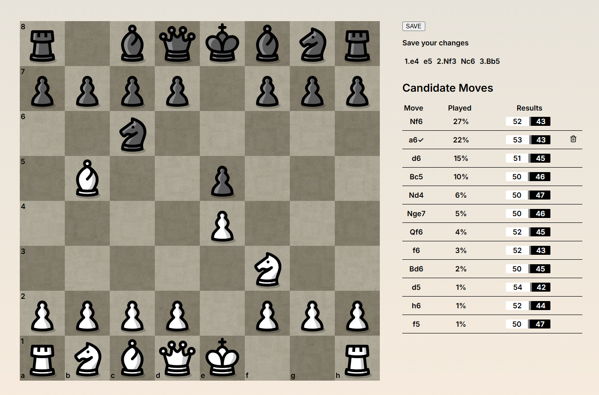

# Chess Trainer

A chess opening trainer inspired by [Chessbook](https://www.chessbook.com). Build an opening repertoire by playing through positions, see which moves real players choose (currently 1000–1199 rated games from the Lichess Opening Explorer), and save it to your own backend.


**Live demo:** https://chess-trainer-gcipriani.vercel.app (saving repertoires isn't available in the live demo yet)



## Features

- A chess rules engine written from scratch, with legal move validation
- A candidate moves panel that updates after every move, showing how often each move is played and how those games turned out
- Repertoire building: every move you play is added to a repertoire draft, added moves are marked with ✓, and a trash button removes a move along with everything after it
- Saving to a PostgreSQL database through a FastAPI backend, so a repertoire survives a page refresh
- Undo and redo with piece animations, and a move timeline in standard notation

## Tech stack

**Frontend:** React 19 · TypeScript (strict) · Vite · Vitest

**Backend:** Python · FastAPI · PostgreSQL · psycopg · Docker Compose

**Infrastructure:** GitHub Actions · Vercel (hosting and a serverless function) · Lichess Opening Explorer API

## How it works

- **Engine.** Move generation, check detection and special moves are plain TypeScript functions, separate from the React components.
- **State.** The game history is stored as a list of positions, with an index pointing at the current one. Undo and redo just move the index.
- **Repertoire tree.** A repertoire is a tree of moves. Changes never edit the tree in place: adding or removing a move copies only the nodes on the path to it, and reuses every other branch. To find the current position in the tree, the app follows the moves played from the root.
- **Serverless proxy.** The Lichess Opening Explorer needs an API token, so the browser calls a small Vercel function (`/api/explorer`), which adds the token on the server and forwards the request.
- **Backend.** Each move is stored as a row pointing to its parent (the previous move). Loading turns the rows into a nested tree in O(n), using a dictionary of nodes by id. Saving replaces the whole tree inside one transaction, so if something fails, the changes are rolled back. All queries are parameterised to prevent SQL injection.

## Running locally

### Backend

See [`chess-backend/README.md`](chess-backend/README.md).

### Frontend

You'll need Node.js, the [Vercel CLI](https://vercel.com/docs/cli) (`npm install -g vercel`), and a [Lichess API token](https://lichess.org/account/oauth/token) with no scopes selected.

```bash
cd chess-frontend
npm install
cp .env.example .env.local               # points the app at the backend
vercel link                              # create or link a Vercel project
vercel env add LICHESS_TOKEN development # paste your token when prompted
vercel dev                               # runs the app at http://localhost:3000
```

## Tests

```bash
cd chess-frontend
npm test
```

Tests cover FEN generation, board updates and check detection. CI runs the tests, a type check and a production build on every push to `main`.

## Roadmap

- [ ] Repertoire picker (the app currently uses a fixed repertoire)
- [ ] Save individual changes instead of replacing the whole tree
- [ ] Move the Lichess proxy into the backend
- [ ] Containerise the FastAPI backend with Docker Compose
- [ ] Options menu for changing rating bracket
- [ ] Spaced-repetition training

See the [issues](https://github.com/gabrielcipriani/chess-trainer/issues) for everything else planned.